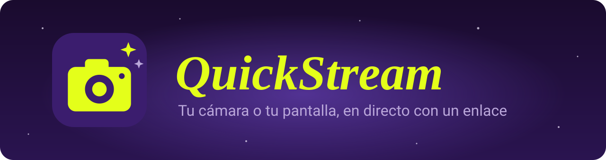
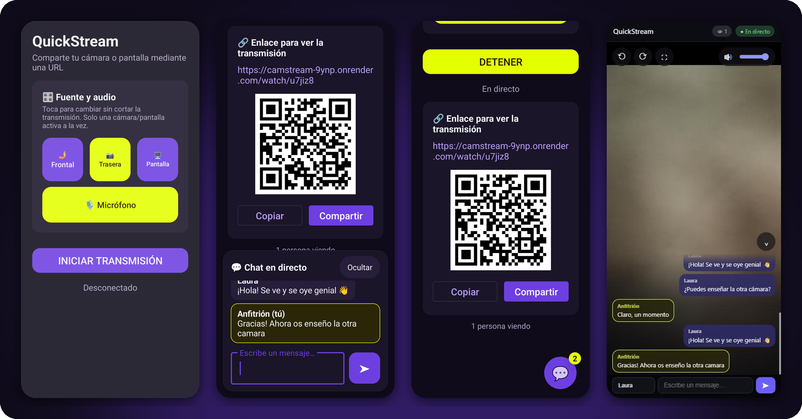
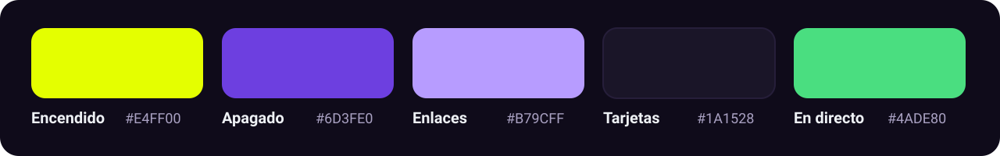

<p align="center"></p>

<p align="center"><b>Emite la cámara o la pantalla de tu móvil y compártela con un simple enlace.</b><br>
Quien lo abra te ve en directo desde cualquier navegador, sin instalar nada.</p>

<p align="center"></p>

---

## Instálala en tu móvil

<table>
<tr>
<td width="46%" align="center">

</td>
<td>

**1. Escanea el código** con la cámara del móvil, o toca el botón:

<a href="https://github.com/FJSSabido/quickstream/releases/latest/download/QuickStream.apk"></a>

**2. Abre el archivo descargado** desde la notificación o desde la carpeta *Descargas*.

**3. Toca «Instalar».** Si el móvil avisa de que es una app de fuera de Play Store, toca *Ajustes* y activa *Permitir desde esta fuente*. Solo hay que hacerlo una vez.

</td>
</tr>
</table>

> Funciona en móviles **Android** (versión 8 o posterior). Para **ver** una emisión no hace falta instalar nada: sirve cualquier móvil, tablet u ordenador, también iPhone.

## Cómo se usa

**1. Elige qué quieres emitir.** Toca uno de los botones grandes: **Frontal**, **Trasera** o **Pantalla**. El que está en **amarillo** es el que está encendido; los **morados** están apagados. El botón **Micrófono** funciona igual.

**2. Toca «Iniciar transmisión».** La primera vez te pedirá permiso para usar la cámara, el micrófono y las notificaciones: acepta los tres. Si eliges *Pantalla*, el móvil te preguntará también si quieres compartir la pantalla entera o solo una app.

**3. Comparte el enlace.** En unos segundos aparece **En directo**, con un enlace y un código QR. Toca *Compartir* para mandarlo por WhatsApp, Telegram o donde quieras, o deja que lo escaneen con la cámara.

**4. Cambia sobre la marcha.** Con la emisión en marcha puedes pasar de una cámara a otra o a la pantalla, y encender o apagar el micrófono. Quien te está viendo no pierde la conexión. Si tocas la fuente que ya está encendida, se apaga y se emite solo el sonido.

**5. Charla con quien te ve.** El **chat en directo** flota sobre la pantalla. Toca *Ocultar* para plegarlo: queda una burbuja 💬 que avisa con un número amarillo cuando llegan mensajes nuevos. Tus mensajes aparecen con borde amarillo y la etiqueta *Anfitrión*.

**6. Termina cuando quieras** con *Detener*, o desde la notificación que se queda fija mientras emites.

## Para quien te ve

Abre el enlace en el navegador (Chrome, Safari, Firefox…) y toca *Reproducir*. Ya está.

- **⟲ ⟳** giran la imagen si se ve de lado. **⛶** la pone a pantalla completa.
- **🔊** y la barra de volumen ajustan el sonido. Solo afectan a ese espectador.
- **El chat** aparece abajo, encima del vídeo. En el móvil se pliega con su botón redondo para ver la imagen despejada. Se puede poner un nombre (el navegador lo recuerda). Si no, aparece como *Invitado*.
- Si quien emite apaga la cámara o el micrófono, aparece un icono tachado 🎥 / 🎙️ en vez de una imagen congelada.

## Preguntas frecuentes

<details>
<summary><b>¿Alguien puede grabar o ver mi emisión sin el enlace?</b></summary>
<br>
El vídeo y el sonido viajan directos de tu móvil a quien te ve. No pasan por ningún servidor ni se graban. Para verla hace falta el enlace, que lleva un código de sala aleatorio. El chat se borra al terminar la emisión.
</details>

<details>
<summary><b>Quien me ve dice que la imagen está en negro</b></summary>
<br>
Si estás compartiendo la <b>pantalla</b>, algunos móviles (OnePlus, OPPO, Xiaomi…) tienen una función de privacidad que tapa la pantalla mientras se comparte. Búscala en <i>Ajustes</i> como <i>«Protección al compartir pantalla»</i> y desactívala, o emite con la cámara.<br><br>
Si pasa con la <b>cámara</b>, suele ser una red muy restrictiva (algunas WiFi de empresa o datos móviles de ciertos operadores). Prueba a cambiar de WiFi a datos o al revés.
</details>

<details>
<summary><b>En iPhone no se ve nada</b></summary>
<br>
Abre el enlace directamente en <b>Safari</b>, no dentro de WhatsApp o Instagram. El navegador que llevan esas apps dentro no siempre es compatible.
</details>

<details>
<summary><b>La emisión tarda un poco en arrancar</b></summary>
<br>
Si nadie ha usado QuickStream en un rato, el servidor puede tardar hasta un minuto en despertar. Las siguientes veces arranca en segundos.
</details>

<details>
<summary><b>¿Gasta mucha batería o datos?</b></summary>
<br>
La cámara emite con la mejor calidad que permite tu móvil (hasta 4K) y se adapta sola si la red va justa. En emisiones largas el móvil se calienta más y gasta más batería, como al grabar vídeo. Con datos móviles, ten en cuenta que una hora en buena calidad puede consumir varios GB.
</details>

<details>
<summary><b>¿Cómo la actualizo a una versión nueva?</b></summary>
<br>
Escanea el mismo código QR y vuelve a instalar.
</details>

## Colores

Fondo de noche con morado y amarillo fosforito: amarillo es *encendido*, morado es *apagado*, en los botones, el chat y el icono.

<p align="center"></p>

---

<details>
<summary>Para desarrolladores</summary>
<br>

### Qué hay en el repositorio

```
android-app/   app de Android (Kotlin) — se abre con Android Studio
server/        servidor de señalización (Node.js) + página web del espectador
assets/        imágenes de este README
```

El vídeo y el audio van por **WebRTC peer-to-peer**. El servidor solo presenta a los dos lados al principio y reenvía los avisos pequeños: el chat, los iconos de «sin señal» y el contador de espectadores. Nunca ve el vídeo.

### Compilar la app

1. Abre `android-app/` en Android Studio (*File → Open*) y espera al *Gradle Sync*.
2. *Build → Build APK(s)*, o desde terminal: `./gradlew assembleDebug`. El APK queda en `android-app/app/build/outputs/apk/debug/app-debug.apk`.
3. Para publicar una versión nueva, renombra el APK a `QuickStream.apk` y súbelo como archivo de una *release* de GitHub. El QR y el botón de descarga siempre apuntan a la última release.

La app usa por defecto el servidor de `DEFAULT_SERVER_URL` (en `MainActivity.kt`) y genera una sala aleatoria que se guarda entre usos. La tarjeta de conexión (servidor, sala y contraseña) sigue en el layout, oculta (`cardConnection`), por si hace falta volver a mostrarla.

### Desplegar el servidor

En Render.com (gratis): *New → Web Service*, root directory `server`, build `npm install`, start `npm start`. En local: `cd server && npm install && npm start` y abre `http://localhost:8080`.

**TURN opcional (Cloudflare Realtime).** Hace falta en redes con NAT restrictivo, donde la conexión directa no llega a establecerse. Crea una *TURN Key* en Cloudflare y define las variables de entorno `CF_TURN_KEY_ID` y `CF_TURN_API_TOKEN` en el servidor. La app y la web piden credenciales temporales (24 h) a `/turn-credentials`. El token nunca sale del servidor.

### Notas técnicas

- **Calidad de imagen:** se captura hasta 4K. El techo de bitrate sube con la resolución (de 2,5 a 20 Mbps) y WebRTC equilibra nitidez y fluidez cuando la red no da. El techo de captura está en `MAX_CAPTURE_WIDTH`/`MAX_CAPTURE_HEIGHT` (`WebRtcClient.kt`).
- **Audio:** cancelación de eco, control de ganancia, supresión de ruido y filtro de graves. Opus va con bitrate alto, `useinbandfec` activado y `usedtx` desactivado.
- **Safari:** `watch.html` incluye el arreglo para páginas que solo reciben vídeo, que si no se quedan sin conectar.
- **Una sala = un móvil emitiendo**, con varios espectadores a la vez. La contraseña de sala (si se usa) es una protección básica, no cifrado.
- **Dependencia WebRTC:** `io.github.webrtc-sdk:android` en `app/build.gradle.kts`. Si una versión deja de existir, usa la más reciente de mvnrepository.

</details>
